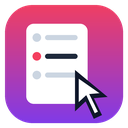

<p align="center"></p>

<h1 align="center">StepCrumbs</h1>
<p align="center"><b>Leave a trail of crumbs as you work. Get a step-by-step guide when you're done.</b></p>
<p align="center">
  
  
  
  <a href="https://github.com/aayushpatel1200/stepcrumbs/releases"></a>
</p>

StepCrumbs is a free, open-source browser extension that records what you do in any web UI (clicks, typing and shell commands) and turns it into a clean, annotated guide. When you're done, take a one-click pack to **Claude**, tell it what the recording can't show, and paste its write-up back. It's built for people who **learn in public**: homelabbers, cloud and DevOps engineers, students building a portfolio.

Record your Proxmox cluster build, your AWS VPC setup, or your GitHub Actions pipeline, then export a **LinkedIn carousel PDF**, a **short video**, a **printable SOP** and a **portfolio web page**.

## Features

| | |
|---|---|
| **Write with Claude** | One click exports a pack: instructions, every step with its exact labels and commands, your notes in place, and the screenshots with your blurs applied. Attach it in Claude, answer its questions about what went wrong and why, and paste the reply back. StepCrumbs fills the step text, sections, warnings, expected results, intro, SOP fields, troubleshooting and LinkedIn post. Titles that drop or invent a UI label are rejected, your own edits are kept, and **Undo** puts everything back. |
| **Auto-captured steps** | Every click becomes a step with a highlighted arrow and an outlined element. Titles write themselves: "Click **Create VM**", "Select **t3.micro** for **Instance type**". |
| **Typing & shell commands** | Form input becomes "Type `web01` in **Name**". Commands in browser terminals (xterm.js, noVNC) become copyable code blocks, with a screenshot of the output. |
| **Secrets stay secret** | Password fields are never recorded. Press a hotkey to mute typing. **Auto-blur** hides AWS account IDs, ARNs, access keys, emails, public IPs and long tokens in screenshots. Blur and redact tools are in the editor. |
| **Notes as you go** | A side-panel Notes tab for *Challenge → Solution → Tip*. Each note lands at that exact point in the guide and in a "Problems I hit & how I fixed them" section. |
| **Easy editing** | Pause and resume, delete with undo, reorder, edit titles, move the arrow, crop, star key steps. A **Projects** window lets you rename, back up or delete projects (with undo), one or many at a time. |
| **Exports** | LinkedIn carousel PDF (1080×1350, light and printable, auto-zoomed for phones) · **captioned MP4 video** (4:5, 9:16 or 16:9) · **SOP** (purpose, checklist, numbered procedure, expected results, troubleshooting table, revision history; Letter/A4) · blog-style guide · single-file HTML · website kit · LinkedIn post · JSON backup |
| **Human and trustworthy** | Light "paper" design, your name and initials, "tested on" versions, real screenshots with sensitive info blurred, and a writing style guide (no hype words, no em dashes). You can paste a post you wrote so Claude matches your voice. |
| **Works anywhere** | Proxmox, TrueNAS, pfSense, AWS / Azure / GCP consoles, GitHub, router UIs… It recognizes the stack and sets the wording and hashtags to match (homelab, cloud, DevOps, networking, security, dev). |
| **Private** | No account, no server, no analytics, no network calls. Everything is stored in your browser until you export it. See [PRIVACY.md](PRIVACY.md). |

## Install

**Microsoft Edge:** get it from Edge Add-ons (link coming once the listing is approved).

**Chrome, or the latest code:**

1. Download the latest zip from [Releases](https://github.com/aayushpatel1200/stepcrumbs/releases), or **Code → Download ZIP** on this page, and extract it. Or `git clone https://github.com/aayushpatel1200/stepcrumbs.git`.
2. Open `chrome://extensions` (Edge: `edge://extensions`) and turn on **Developer mode**.
3. Click **Load unpacked** and select the **`extension`** folder.
4. Pin the StepCrumbs icon. A welcome page walks you through the rest.

## Use

1. Open the web UI you're working in and click the StepCrumbs icon. The side panel opens.
2. Create a project and press **Start recording**. Work normally.
3. Log what was tricky in the **Notes** tab while it's fresh.
4. **Stop**, then **Editor & export**: tidy up, check the Privacy panel, star 6–10 key steps.
5. **Write with Claude**: download the pack, talk it through in Claude, paste the reply back. Then export.

While you record, the side panel shows whether the tab you're on is connected. Tabs that were open before you installed or reloaded StepCrumbs are connected automatically.

| Shortcut | Action |
|---|---|
| <kbd>Alt</kbd>+<kbd>Shift</kbd>+<kbd>P</kbd> | Pause / resume |
| <kbd>Alt</kbd>+<kbd>Shift</kbd>+<kbd>M</kbd> | Mute typing (before passwords) |
| <kbd>Alt</kbd>+<kbd>Shift</kbd>+<kbd>S</kbd> | Manual snapshot |
| <kbd>Alt</kbd>+<kbd>Shift</kbd>+<kbd>N</kbd> | Open Notes |

Change them at `chrome://extensions/shortcuts`.

## Write it up with Claude

1. In the editor, click **Write with Claude** → **Download pack (.zip)**. It contains `CLAUDE-START-HERE.md` (the instructions and reply format), `steps.md` / `steps.json` (every step, your notes in place) and `screenshots/` (with your blurs and redactions applied).
2. Attach the pack in Claude and tell it what the recording can't show: why you built it, what went wrong, what fixed it, your hardware and versions. Claude may ask a few questions first.
3. Paste Claude's whole reply into the same dialog (or open the `stepcrumbs-reply.json` file it made) and click **Apply to my guide**.

No zip support where you're chatting? Use **Copy as text** and attach a few key screenshots yourself. The pack is plain Markdown, so other assistants can use it too.

## How it works

```
extension/
├── manifest.json     MV3 manifest (side panel, content script, shortcuts)
├── content.js        Runs in every page: names what you clicked, captures typing/commands, finds sensitive text to blur
├── background.js     Service worker: takes screenshots, merges related events into one step, connects open tabs
├── db.js             IndexedDB storage (projects, steps/notes, screenshots)
├── sidepanel.*       Recorder controls, live step list, Notes tab
├── editor.*          Review & edit: titles, arrow, blur/redact/crop, reorder, privacy check, exports
├── render.js         Draws arrows, highlights, blurs and crops onto screenshots (non-destructive)
├── claude.js         Claude handoff: the pack (instructions + steps + screenshots), reading the reply, applying it, undo
├── writing.js        House style, text clean-up and the title checks that keep labels and values honest
├── model.js          Turns the timeline into sections, steps, troubleshooting, SOP header and trust facts
├── slides.js         Canvas toolkit + the LinkedIn carousel
├── video.js          Animated captioned video (WebCodecs → MP4 / WebM)
├── exporters.js      Guide + SOP HTML, Markdown kit, post text, privacy check, ZIP, backup
├── pdf.js            Tiny PDF writer for the carousel
├── vendor/           mp4-muxer and webm-muxer (MIT) for the video export
├── util.js           Shared helpers, project types, stack detection
└── preview.* / welcome.html
tests/
├── unit.mjs          Fast tests for the title checks, humanizer, Claude pack and reply parsing, and the data model
├── connect.mjs       Installs and reloads the extension while a tab is open; every click must still be captured once
├── e2e.mjs           Playwright test: records on mock UIs, does a Claude round trip (export, paste, undo), checks every export
└── fixtures/         Mock Proxmox and AWS console pages
```

No build step: it's plain JavaScript, so you can edit a file and click reload. The only bundled libraries are the two small MIT muxers in `vendor/`.

## Contributing

Contributions are very welcome. Please send them as **pull requests to this repository** so everyone gets the improvement. Read [CONTRIBUTING.md](CONTRIBUTING.md) to get started. Good first ideas:

- Better step titles for a UI you use (Azure, GCP, TrueNAS, UniFi…) in `describe()` in `content.js`
- A Firefox port (sidebar instead of side panel)
- More export templates (Notion, dev.to, Hashnode)
- Translations

## Publishing

- `npm run package` builds `dist/stepcrumbs-<version>-store.zip`: `manifest.json` at the root, the `"key"` field removed (it only pins the ID for **Load unpacked**; stores assign their own).
- **Microsoft Edge Add-ons**: no developer fee. **Chrome Web Store**: one-time $5 developer registration.
- Store texts, privacy answers and images live in [`store/`](store/).

## License

[MIT](LICENSE) © 2026 Aayush Patel. The MIT license covers the code. The StepCrumbs name and logo identify this project, so please give a fork its own name.
